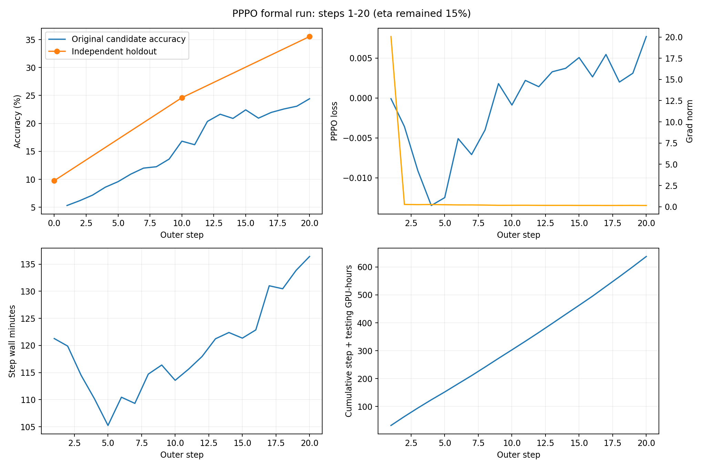
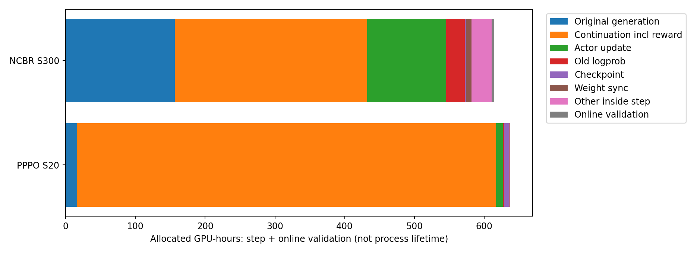
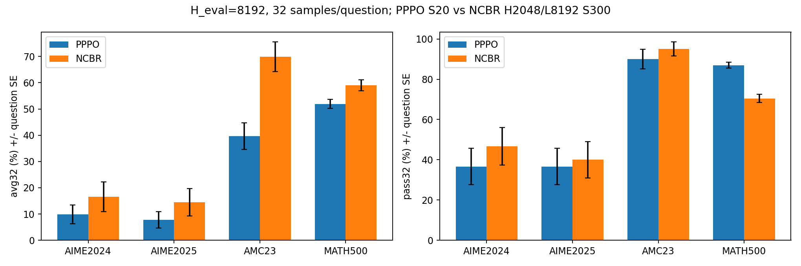

# PPPO Step20 与 NCBR H=2048/L=8192 Step300 对比报告

生成时间：2026-11-14T05:17:04.121372+00:00。仅比较这两组模型，不纳入 vanilla DAPO 或其他 NCBR 长度配置。

## 1. 结论与比较边界

PPPO 正式训练已安全暂停在 Step20（实际 320 次 optimizer update），NCBR 历史实验为 Step300。训练进程口径分别为 641.941 与 628.650 GPU-hours，PPPO 高 2.114%；这是近似预算对照，不是严格相同算力或相同训练步数对照。

在相同 H_eval=8192、每题32次采样的离线协议下，PPPO 的四个题库 Pass@1/Avg@32 均低于 NCBR；MATH-500 Pass@32 更高。单次正确率与32次尝试覆盖率是不同指标，不能据后者宣称整体优于 NCBR。仅一个训练种子，不能把题目 bootstrap 当成跨训练种子显著性。

PPPO 的 holdout 改善表明独立开发集上的训练进展，但不能替代 AIME/AMC/MATH500 测试结果，也不能与 NCBR 的在线 AIME 分数直接比较。

## 2. PPPO 训练动态

| 验证 step | 独立 holdout 准确率 | eta |
|---|---|---|
| 0 | 9.7656% | 15 |
| 10 | 24.6094% | 15 |
| 20 | 35.5469% | 15 |

Holdout 为256个唯一题目；eta 全程15%，尚未发生 plateau 上调。规则 patience=3、min_delta=0、cooldown=1、每10步验证，为复现补全，并非确认来自原作者代码。

| step | 原始候选正确率 | 累计奖励均值 | loss | grad norm | 分钟/step | 累计更新 |
|---|---|---|---|---|---|---|
| 1 | 5.32% | 0.5243 | -0.000087 | 20.05647 | 121.28 | 16 |
| 2 | 6.18% | 0.6042 | -0.003569 | 0.26314 | 119.89 | 32 |
| 3 | 7.18% | 0.7393 | -0.009093 | 0.24527 | 114.50 | 48 |
| 4 | 8.59% | 0.8387 | -0.013453 | 0.25690 | 110.14 | 64 |
| 5 | 9.59% | 0.9678 | -0.012467 | 0.23265 | 105.25 | 80 |
| 6 | 10.94% | 1.0459 | -0.005085 | 0.20939 | 110.46 | 96 |
| 7 | 12.01% | 1.1515 | -0.007082 | 0.20800 | 109.32 | 112 |
| 8 | 12.26% | 1.1629 | -0.004007 | 0.19059 | 114.72 | 128 |
| 9 | 13.62% | 1.3024 | 0.001797 | 0.16423 | 116.39 | 144 |
| 10 | 16.83% | 1.5135 | -0.000885 | 0.16644 | 113.57 | 160 |
| 11 | 16.19% | 1.4434 | 0.002200 | 0.17015 | 115.63 | 176 |
| 12 | 20.36% | 1.8040 | 0.001411 | 0.15829 | 117.96 | 192 |
| 13 | 21.65% | 1.9692 | 0.003278 | 0.15503 | 121.23 | 208 |
| 14 | 20.90% | 1.8761 | 0.003712 | 0.15844 | 122.39 | 224 |
| 15 | 22.43% | 2.0010 | 0.005057 | 0.14990 | 121.35 | 240 |
| 16 | 20.95% | 1.9035 | 0.002640 | 0.15038 | 122.87 | 256 |
| 17 | 21.97% | 1.9507 | 0.005447 | 0.14310 | 131.01 | 272 |
| 18 | 22.59% | 2.0181 | 0.001991 | 0.14734 | 130.46 | 288 |
| 19 | 23.08% | 2.1082 | 0.003095 | 0.15369 | 133.85 | 304 |
| 20 | 24.41% | 2.1665 | 0.007689 | 0.14089 | 136.41 | 320 |

原始候选正确率的分母是当步生成的候选回答；累计奖励范围0–9；均不同于筛选后的训练 reward，也不同于固定测试集成绩。PPPO loss 使用原始总长度归一化，不能直接拿其数值或 grad norm 大小与 NCBR 判断优化优劣。

## 3. 真实 GPU-hours 与生成/更新开销

| 口径 | PPPO S20 | NCBR S300 |
|---|---|---|
| 进程链 GPU-hours | 641.941 | 628.650 |
| step timer GPU-hours | 636.979 | 610.598 |
| 在线验证 timer GPU-hours（step外） | 0.558 | 3.779 |
| step + testing GPU-hours | 637.537 | 614.377 |
| 平均 step timer 分钟 | 119.43 | 7.63 |

GPU-hours=资源保留期间墙钟时间×16/3600，不是按GPU利用率或功率积分。NCBR进程链包含原始1–20步与恢复后21–300步；PPPO进程终点取Step20 committed sidecar时间。启动/Step0验证等边界开销落在进程口径中，step计时不能覆盖全部。两者周期在线验证位于step计时之外；checkpoint计时已在step内，不得重复相加。

PPPO committed保存到driver退出另有 0.12955 GPU-hours，单列，不算作Step20模型训练成本。正式训练首次从Base初始化，未从smoke/profiling checkpoint继续。

| 阶段（互斥归类） | PPPO GPU-h | NCBR GPU-h |
|---|---|---|
| Original generation | 16.667 | 156.831 |
| Continuation incl reward | 600.415 | 275.199 |
| Actor update | 9.591 | 113.396 |
| Old logprob | 1.538 | 26.539 |
| Checkpoint | 7.727 | 2.477 |
| Weight sync | 0.583 | 7.143 |
| Other inside step | 0.458 | 29.013 |
| Online validation | 0.558 | 3.779 |

PPPO continuation总阶段包含其生成、评分和调度，内部嵌套timer未重复相加；NCBR使用continuation与long reward计时。各阶段乘16表示此阶段占用整个训练资源池的机会成本，不表示所有16卡都执行该阶段内核。

| 累计统计 | PPPO S20 | NCBR S300 |
|---|---|---|
| original_rows | 122,880 | 1,849,344 |
| continuation_rows | 983,040 | 184,375 |
| original_tokens | 130,241,952 | 2,205,946,733 |
| continuation_decoded_tokens | 1,024,959,243 | 177,607,270 |
| continuation_prefill_tokens | 306,307,784 | 406,695,201 |
| actor_optimized_tokens | 6,272,112 | 774,330,760 |
| actor_rows | 40,960 | 614,400 |
| actor实际输入tokens（含prompt） | 12,425,859 | 本报告未重建，不与response tokens混用 |

PPPO 候选组共 15,360，零方差筛掉 3,873，另有有效但超出目标批大小的组 6,367；全部候选原始生成和续写成本均已计入，不能只计算保留的256组。每候选批为6144条原始回答+49152条额外续写。

PPPO 的 continuation 阶段占 step timer 94.26%，actor update 占 1.51%。这解释了为什么前缀actor计算较少，整体仍可比300步NCBR昂贵：G=8续写覆盖所有原始分支，而NCBR只对命中短边界的轨迹续写一次。不得将15% prefix比例表述成85% GPU-hours节省。

NCBR candidate response token总量来自历史审计的 EXACT_OR_INTEGER_RECOVERED 汇总，并非本报告重新跑推理计数。NCBR 4800次更新为300×16理论值，历史表中未提供逐步optimizer计数；本报告不把理论值冒充实测。

## 4. 算法流程对照

**PPPO + DAPO Dynamic Sampling（NCBR-Matched）**：每题先生成N=8条完整原始回答，cap=8192；每条按floor(eta×实际长度)保留prefix，再从原prompt IDs+prefix IDs独立生成G=8条continuation，总回答长度仍≤8192。对原始回答和8条续写做binary correctness评分并求和，在同题8个原始分支内标准化advantage；全分支评分后用累计奖励进行动态筛选。只对原始分支prefix执行clipped PPO，续写不进入actor样本。每题分母为该题8条原始完整回答长度之和，不能改为prefix长度和。可写作：L_q = -[Σ_i Σ_{t≤floor(eta L_i)} min(r_it A_i, clip(r_it,0.8,1.28) A_i)] / [Σ_i L_i]。

**NCBR H2048/L8192**：先生成N=8条短回答，H=2048。只对命中短response cap且未正常结束的轨迹，从原prompt+短prefix自然续写一次至总L=8192（最多额外6144 tokens）；不是仅对全错组或仅对错答续写。长回答只用于reward。短轨迹末端reward加上 task_score_long − task_score_short，保留原短回答overlong shaping残差。最终仍对原短回答（≤2048）的全部有效response tokens做DAPO/GRPO更新，续写tail不进入actor loss。replace模式动态筛选实际用boundary_acc；虽然配置字段写acc，代码会覆盖，不能误称先按原短acc过滤。

两者均保持同版本on-policy生成、完整组筛选及每步256×8条actor轨迹；共同使用非对称clip 0.20/0.28。PPPO关闭dual-clip、overlong shaping；NCBR dual-clip c=3并保留长度410、系数1的overlong buffer。两者均关闭critic、KL reward/loss和entropy bonus。本对比中的PPPO不是未经修改的原论文采样协议。

## 5. 实际训练配置

| 字段 | PPPO | NCBR H2048/L8192 |
|---|---|---|
| data.train_batch_size | 256 | 256 |
| data.gen_batch_size | 768 | 768 |
| data.max_prompt_length | 1024 | 1024 |
| data.max_response_length | 8192 | 2048 |
| data.shuffle | true | true |
| data.seed | null | null |
| data.dataloader_num_workers | 8 | 8 |
| trainer.nnodes | 2 | 2 |
| trainer.n_gpus_per_node | 8 | 8 |
| trainer.total_epochs | 2 | 1 |
| trainer.total_training_steps | 300 | 300 |
| trainer.save_freq | 1 | 50 |
| trainer.test_freq | 10 | 10 |
| trainer.resume_mode | "disable" | "resume_path" |
| trainer.val_before_train | true | false |
| actor_rollout_ref.model.path | "/workspace/models/Qwen3-4B-Base" | "/workspace/models/Qwen3-4B-Base" |
| actor_rollout_ref.model.enable_gradient_checkpointing | true | true |
| actor_rollout_ref.actor.ppo_mini_batch_size | 16 | 16 |
| actor_rollout_ref.actor.ppo_micro_batch_size_per_gpu | 1 | 1 |
| actor_rollout_ref.actor.ppo_epochs | 1 | 1 |
| actor_rollout_ref.actor.shuffle | false | false |
| actor_rollout_ref.actor.data_loader_seed | 42 | 42 |
| actor_rollout_ref.actor.optim.lr | 1e-06 | 1e-06 |
| actor_rollout_ref.actor.optim.weight_decay | 0.01 | 0.01 |
| actor_rollout_ref.actor.optim.betas | [0.9, 0.999] | [0.9, 0.999] |
| actor_rollout_ref.actor.optim.lr_scheduler_type | "constant" | "constant" |
| actor_rollout_ref.actor.optim.lr_warmup_steps | 0 | 0 |
| actor_rollout_ref.actor.grad_clip | 1.0 | 1.0 |
| actor_rollout_ref.actor.fsdp_config.param_offload | false | false |
| actor_rollout_ref.actor.fsdp_config.optimizer_offload | true | true |
| actor_rollout_ref.actor.fsdp_config.model_dtype | "fp32" | "fp32" |
| actor_rollout_ref.actor.fsdp_config.dtype | "bfloat16" | "bfloat16" |
| actor_rollout_ref.actor.fsdp_config.seed | 42 | 42 |
| actor_rollout_ref.actor.ulysses_sequence_parallel_size | 1 | 1 |
| actor_rollout_ref.actor.clip_ratio_low | 0.2 | 0.2 |
| actor_rollout_ref.actor.clip_ratio_high | 0.28 | 0.28 |
| actor_rollout_ref.actor.clip_ratio_c | null | 3.0 |
| actor_rollout_ref.actor.entropy_coeff | 0 | 0 |
| actor_rollout_ref.actor.use_kl_loss | false | false |
| actor_rollout_ref.rollout.n | 8 | 8 |
| actor_rollout_ref.rollout.tensor_model_parallel_size | 2 | 2 |
| actor_rollout_ref.rollout.nnodes | 0 | 0 |
| actor_rollout_ref.rollout.log_prob_micro_batch_size_per_gpu | 2 | 2 |
| actor_rollout_ref.rollout.temperature | 1.0 | 1.0 |
| actor_rollout_ref.rollout.top_p | 1.0 | 1.0 |
| actor_rollout_ref.rollout.top_k | -1 | -1 |
| actor_rollout_ref.rollout.ignore_eos | false | false |
| actor_rollout_ref.rollout.max_model_len | 9216 | 9216 |
| actor_rollout_ref.rollout.max_num_seqs | 256 | 256 |
| actor_rollout_ref.rollout.max_num_batched_tokens | 32768 | 32768 |
| actor_rollout_ref.rollout.gpu_memory_utilization | 0.5 | 0.5 |
| algorithm.filter_groups.metric | "pppo_filter_reward" | "acc" |
| algorithm.filter_groups.max_num_gen_batches | 10 | 10 |
| reward.reward_kwargs.overlong_buffer_cfg.enable | false | true |

硬件：同一2节点，每节点8×A100-SXM4-40GB；FSDP world/actor DP=16、SP=1；rollout TP=2，为8个TP组。rollout.nnodes=0表示共置资源语义，不是零节点运行。两者BF16计算、FP32主模型/优化器状态，optimizer offload=true、parameter offload=false；AdamW 1e-6、betas=(0.9,0.999)、weight_decay=.01、constant、无warmup、grad clip=1。mini-batch16问题=128轨迹，每步16次更新，micro/GPU=1，old-logprob micro/GPU=2。

PPPO额外：cropped actor、固定线性tile=128、BF16 full reduction、continuation seed=42、并发128、请求chunk512、reward chunk256、timeout600s，optimizer audit关闭。BF16验收使用此前获用户授权的log-prob门槛0.06，其余门槛未放宽；这属于实现/数值路径披露，不等于数学精确相等。NCBR续写并发128、请求chunk512、reward chunk256、timeout600s、seed42。data.seed两者均为null，actor dataloader/FSDP seed为42，不将null宣称为显式统一全局seed。

当前PPPO实际save_freq=1（后续用户要求改变保存方式后的正式run），不是最初计划中的50。NCBR save_freq=50；PPPO更多checkpoint I/O是协议开销差异。PPPO总日程仍300，实际仅完成20后暂停，不能线性推算或冒充300步完成结果。

## 6. 数据与在线验证差异

二者源数据为相同历史 DAPO-Math Parquet（SHA256见sources.json）。历史源共有1,791,700行，含重复副本；PPPO按唯一题目身份抽取256题holdout并排除全部副本，训练集1,764,500行，prompt过滤后1,763,700行。NCBR没有排除该holdout，因此不是严格相同训练样本。划分seed42、holdout SHA a0214577119338638f63adb4638130502d5d638928c7159c6b8837c6f9755469。

PPPO在线每10步评估独立holdout（Step0 baseline）；NCBR历史在线每10步使用AIME24/25，不能将这两条在线曲线直接比较。PPPO未把最终AIME、AMC、MATH500测试成绩用于eta调度。MATH500精确规范化文本与训练/holdout匹配为0，仅证明该匹配口径，不能证明不存在语义或预训练重叠。

NCBR原始1–20步来自Base，后从其Step20完整状态恢复继续到300；PPPO本次从同一Base全新初始化。完整配置副本包括NCBR父段与恢复段，保留路径、resume和验证差异。

## 7. 统一8K离线结果

评测：H_eval=8192，每题32样本，temperature=1、top_p=1、top_k=-1、正常EOS；同Base tokenizer、Answer:模板、master seed42派生请求seed、历史math_dapo verifier。Pass@1估计=每题c/32再平均，即Avg@32；Pass@32=至少一次正确的题目比例。SE按题目计算，单位为百分点。历史verifier为规范化字符串匹配，不是通用符号等价判断。

| 题库 | PPPO Avg@32±SE | NCBR Avg@32±SE | 差值pp | PPPO Pass@32±SE | NCBR Pass@32±SE | 差值pp | 平均长度 P/N |
|---|---|---|---|---|---|---|---|
| AIME2024 | 9.90±3.57 | 16.56±5.64 | -6.67 | 36.67±8.95 | 46.67±9.26 | -10.00 | 2233.9/2245.5 |
| AIME2025 | 7.81±3.16 | 14.48±5.17 | -6.67 | 36.67±8.95 | 40.00±9.10 | -3.33 | 1633.2/2143.3 |
| AMC23 | 39.61±5.06 | 69.84±5.67 | -30.23 | 90.00±4.80 | 95.00±3.49 | -5.00 | 1246.0/1415.6 |
| MATH500 | 51.93±1.68 | 59.03±2.03 | -7.10 | 87.00±1.51 | 70.40±2.04 | +16.60 | 697.4/890.2 |

| 题库 | 指标 | PPPO−NCBR(pp) | 配对bootstrap 95%区间 |
|---|---|---|---|
| AIME2024 | avg32 | -6.667 | [-11.875, -2.083] |
| AIME2024 | pass32 | -10.000 | [-23.333, 3.333] |
| AIME2025 | avg32 | -6.667 | [-12.812, -1.667] |
| AIME2025 | pass32 | -3.333 | [-23.333, 16.667] |
| AMC23 | avg32 | -30.234 | [-37.188, -23.516] |
| AMC23 | pass32 | -5.000 | [-12.5, 0.0] |
| MATH500 | avg32 | -7.100 | [-9.156, -5.037] |
| MATH500 | pass32 | +16.600 | [13.0, 20.2] |

NCBR AIME24/25/AMC23使用已冻结历史Step300成绩，已核验权重SHA和原始评分Parquet SHA；MATH500为本轮新生成。PPPO全部四题库为本轮Step20新生成。二者报告所需结果均已PASS，无须等待不在本报告范围内的其他评测组。

PPPO在MATH500的Avg@32降低但Pass@32提高，说明这批32次样本的解题覆盖更广、平均成功次数更少；这不能单凭汇总指标归因于某个算法机制。AIME样本量仅30题，配对区间与训练种子不确定性应一并考虑。

## 8. 离线评测开销与交付

| 本轮评测范围 | GPU-hours（head 8卡保留口径） |
|---|---|
| PPPO四题库19200回答 | 12.768795 |
| NCBR MATH500 16000回答 | 8.823657 |
| 独立诊断256回答 | 0.487923 |
| 失败fork启动（0回答） | 0.034031 |

该评测timer包括加载/生成/评分，worker节点闲置不计作活跃评测GPU。NCBR历史AIME/AMC成本未并入本轮；四题库与单MATH500开销不是同范围比较，不能直接计算效率倍数。失败初始化已保留现场，spawn修复只改变执行方式，未改采样协议。

附件包含完整配置、字段差异、逐步CSV/JSONL、图表、离线结果、配对bootstrap和SHA256来源清单。训练保持暂停，不自动恢复。
